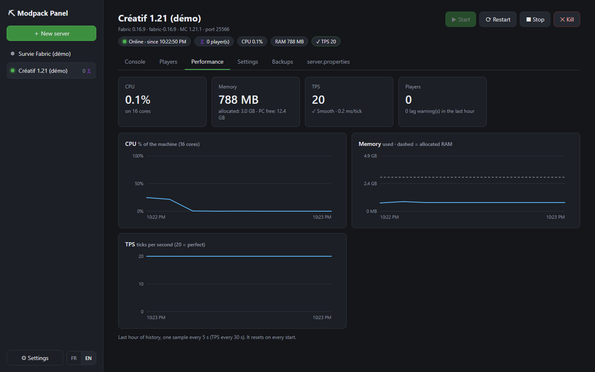

# Minecraft Modpack Panel

[English](README.md) · **Français**

Un panel web léger, auto-hébergé, pour créer et gérer des **serveurs Minecraft moddés** à partir de **modpacks CurseForge**. Tu choisis un modpack et le panel l'installe, avec le bon mod loader et la bonne version de Java. Tu le gères ensuite depuis ton navigateur ou ton téléphone.



## Fonctionnalités

- **Installation de modpacks en un clic** depuis CurseForge. Le panel utilise le *server pack* officiel quand il existe. Sinon, il reconstruit le serveur depuis le pack client (overrides, mods, loader).
- **Mod loaders** : Forge, NeoForge et Fabric, installés automatiquement.
- **Java automatique** : la bonne version (8, 17 ou 21) est téléchargée depuis Adoptium (Eclipse Temurin), avec vérification de la somme de contrôle.
- **Console en direct** (WebSocket), avec historique des commandes (↑/↓).
- **Contrôles** : démarrer, arrêter proprement, redémarrer, forcer l'arrêt. Le serveur redémarre automatiquement après un crash.
- **Joueurs** : liste des joueurs en ligne, op/deop, expulsion, bannissement, whitelist, mode de jeu, joueurs déjà venus.
- **Performances** : CPU, RAM et TPS en direct, avec graphiques sur une heure et alertes de lag. Le TPS est lu via `forge tps`, `neoforge tps` ou `tick query` (1.20.3+), sans encombrer la console.
- **Mods** : liste des mods installés avec leur vrai nom et leur version, activation ou désactivation en un clic (pratique quand un mod fait crasher le serveur), ajout de `.jar` par glisser-déposer, repérage des mods « client uniquement ».
- **Tâches planifiées** : redémarrage chaque nuit avec annonces aux joueurs (5 min et 1 min avant), démarrage, arrêt, sauvegarde ou commande programmés selon les jours de la semaine.
- **Gestionnaire de fichiers** : parcourir le dossier du serveur, modifier les configs (`.toml`, `.json`, `.cfg`…) dans le navigateur, envoyer, télécharger et supprimer des fichiers.
- **Crash reports** : quand un serveur plante, le panel affiche la cause, les mods suspects et les dépendances manquantes, avec un lien vers le rapport complet.
- **Notifications Discord** (webhook) : serveur en ligne ou arrêté, crash avec mods suspects, joueurs qui se connectent ou se déconnectent, sauvegardes ratées.
- **Démarrage avec Windows** : le panel peut se lancer tout seul à l'ouverture de session (sans fenêtre), et chaque serveur peut démarrer automatiquement avec le panel.
- **Plusieurs serveurs** en parallèle, chacun sur son port.
- **Sauvegardes** manuelles ou planifiées. La sauvegarde du monde est mise en pause (`save-off` / `save-all`) pendant la copie. Les anciennes sauvegardes sont supprimées par rotation, et chaque sauvegarde peut être téléchargée ou restaurée.
- Éditeur de `server.properties`, réglage de la RAM et des arguments JVM.
- **Interface bilingue** (English / Français), utilisable aussi sur mobile.

## Prérequis

- [Node.js](https://nodejs.org/) 20 ou plus récent
- Une **clé API CurseForge** gratuite : <https://console.curseforge.com/> → *API Keys*
- Windows, Linux ou macOS. Java est téléchargé automatiquement si besoin.

## Démarrage

```bash
git clone https://github.com/ChoupiViP/minecraft-modpack-panel.git
cd minecraft-modpack-panel
npm install
npm start
```

Puis ouvre <http://localhost:8080> :

1. **Paramètres** : colle ta clé API CurseForge.
2. **Nouveau serveur** : cherche un modpack, choisis la version, accepte l'EULA, puis clique sur **Créer et installer**.
3. Une fois l'installation terminée, clique sur **Démarrer**.

## Accès depuis un téléphone ou un autre PC

Par défaut, le panel n'écoute que sur `127.0.0.1`. Pour y accéder depuis ton réseau local, **définis un mot de passe** : le panel peut lancer des exécutables, il ne faut jamais l'exposer sans.

```powershell
# Windows PowerShell
$env:HOST="0.0.0.0"; $env:PANEL_PASSWORD="change-moi"; npm start
```

```bash
# Linux / macOS
HOST=0.0.0.0 PANEL_PASSWORD=change-moi npm start
```

Ouvre ensuite `http://<ip-du-pc>:8080` sur ton téléphone. N'importe quel identifiant fonctionne avec le mot de passe.

| Variable | Défaut | Description |
|---|---|---|
| `HOST` | `127.0.0.1` | Adresse d'écoute (`0.0.0.0` = tout le réseau) |
| `PORT` | `8080` | Port du panel |
| `PANEL_PASSWORD` | *(aucun)* | Active l'authentification HTTP Basic |

> Exposer le panel sur Internet est déconseillé. Préfère un VPN (Tailscale, WireGuard…) ou un reverse proxy avec HTTPS.

## Démarrage automatique

- **Windows** : dans **Paramètres → Démarrage avec Windows**, clique sur **Activer**. Le panel se lance alors sans fenêtre à l'ouverture de ta session, avec la même adresse, le même port et le même mot de passe qu'actuellement. Coche **Démarrer automatiquement quand le panel se lance** dans les réglages d'un serveur pour qu'il démarre aussi.
- **Linux** : crée un service systemd, par exemple `/etc/systemd/system/mc-panel.service` :

```ini
[Unit]
Description=Minecraft Modpack Panel
After=network-online.target

[Service]
User=minecraft
WorkingDirectory=/opt/minecraft-modpack-panel
Environment=HOST=0.0.0.0 PANEL_PASSWORD=change-moi
ExecStart=/usr/bin/node src/server.js
Restart=on-failure

[Install]
WantedBy=multi-user.target
```

Puis lance `sudo systemctl enable --now mc-panel`.

## Versions de Java

| Minecraft | Java |
|---|---|
| ≤ 1.16.5 | 8 |
| 1.17 – 1.20.4 | 17 |
| ≥ 1.20.5 | 21 |

Les anciens Forge 1.16.5 (avant 36.2.26) plantent avec les versions récentes de Java : le panel les met automatiquement à jour vers la version de Forge recommandée lors de l'installation d'un modpack.

Le panel installe la version requise dans `data/java/` à l'installation d'un modpack. Tu peux aussi installer des versions depuis **Paramètres → Versions de Java**.

## Limites connues

- Certaines clés API CurseForge n'ont pas le droit d'utiliser la recherche complète ni de lister toutes les versions d'un modpack. Le panel affiche alors les modpacks mis en avant et accepte un **ID de projet** (encadré « About Project » de la page du modpack) ; les versions proposées sont les dernières du modpack.

- Certains auteurs interdisent le téléchargement de leurs mods via l'API CurseForge. Ces mods sont listés avec un lien pour les télécharger à la main.
- Quand le serveur est construit depuis un pack client, un mod « client only » peut le faire planter. Dans ce cas, retire-le du dossier `mods`.
- Les packs qui utilisent *ServerStarter* ou des scripts d'installation exotiques peuvent demander une intervention manuelle.
- Le TPS n'est pas mesurable automatiquement sur Fabric avant la 1.20.3, faute de commande intégrée.

## Contribuer

Les issues et les pull requests sont les bienvenues.

- Le projet n'a **pas d'étape de build** : modifie les fichiers et recharge la page. `npm run dev` relance le serveur à chaque modification du backend.
- Lance `npm test` avant d'ouvrir une pull request. Les tests utilisent le lanceur intégré à Node, donc rien à installer. La CI les exécute sous Linux et Windows.
- Chaque nouveau message de l'interface ou du backend doit être ajouté dans les **deux** langues. Un test le vérifie.
- Pour **ajouter une langue**, copie le bloc `en` de [`public/i18n.js`](public/i18n.js) et de [`src/i18n.js`](src/i18n.js), traduis les valeurs, puis ajoute-la à `LANGS`.

## Licence

[MIT](LICENSE) © ChoupiViP

*Projet non affilié à Mojang, Microsoft ou CurseForge/Overwolf. Minecraft est une marque de Mojang Synergies AB.*
