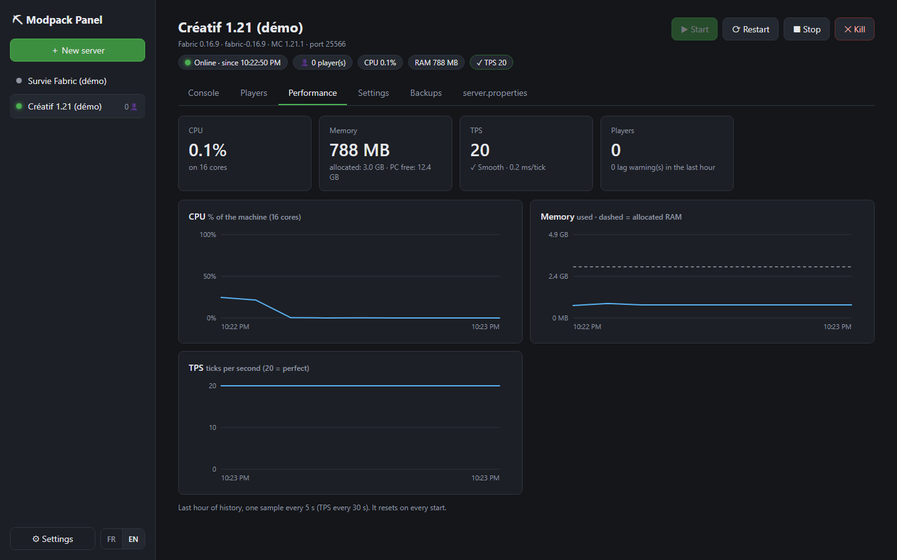
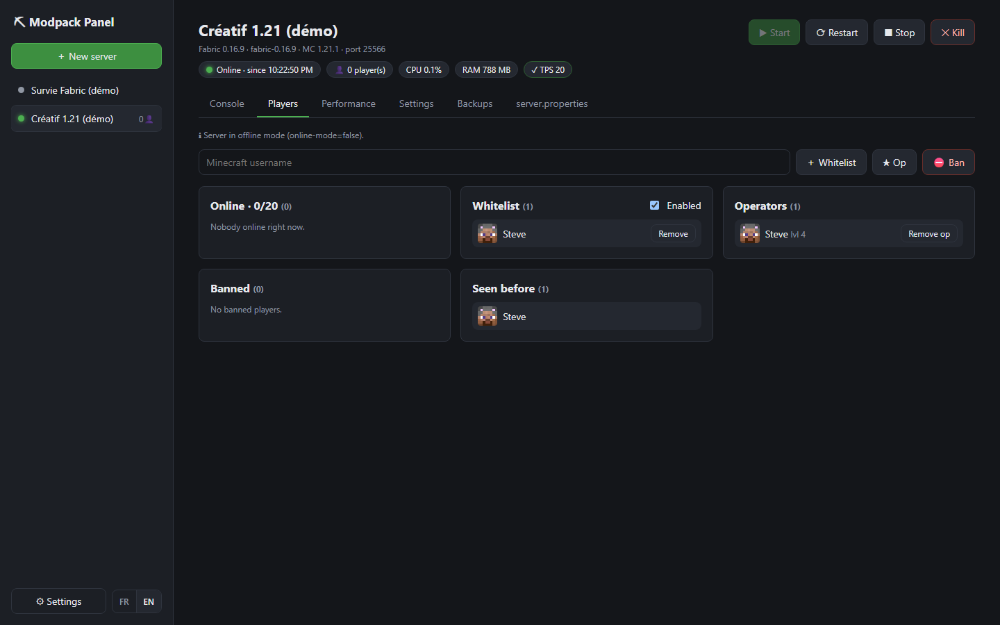
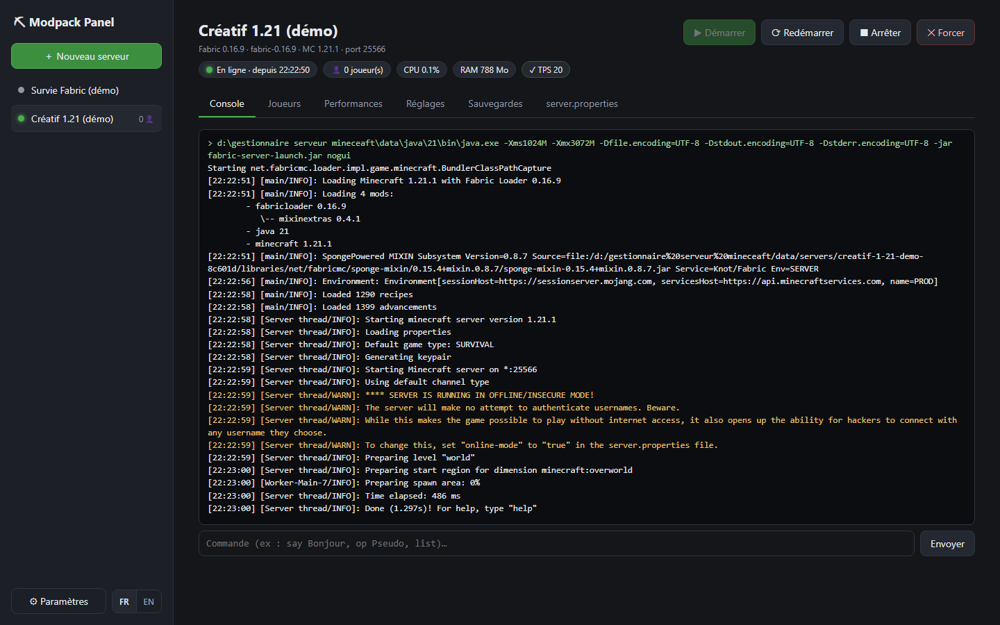
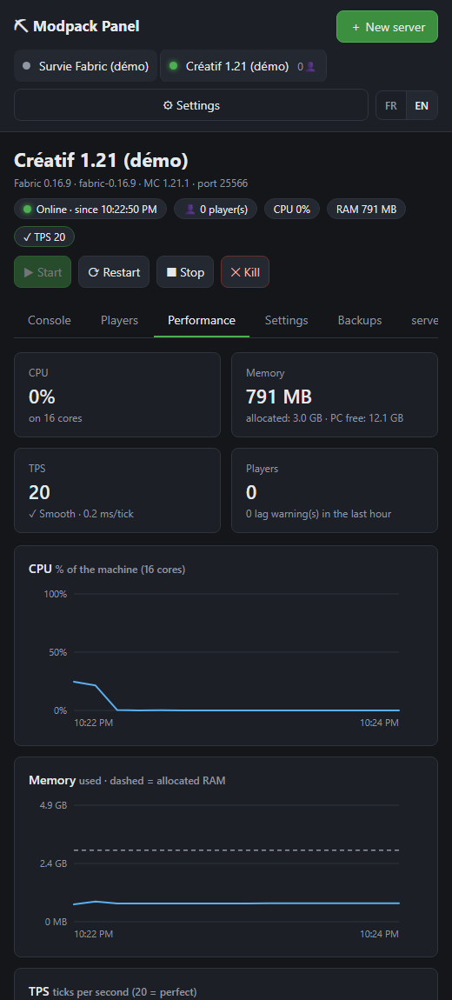

# Minecraft Modpack Panel

**English** · [Français](README.fr.md)

A lightweight, self-hosted web panel to create and manage **modded Minecraft servers** from **CurseForge modpacks**. Pick a modpack and the panel installs it, along with the right mod loader and the right Java version. You then manage it from your browser or your phone.



## Features

- **One-click modpack install** from CurseForge. The panel uses the official *server pack* when there is one. Otherwise it rebuilds the server from the client pack (overrides, mods, loader).
- **Mod loaders**: Forge, NeoForge and Fabric, installed automatically.
- **Automatic Java**: the right version (8, 17 or 21) is downloaded from Adoptium (Eclipse Temurin) and its checksum is verified.
- **Live console** over WebSocket, with command history (↑/↓).
- **Controls**: start, graceful stop, restart and kill. The server restarts automatically after a crash.
- **Players**: online list, op/deop, kick, ban/unban, whitelist, game mode and returning players.
- **Performance**: live CPU, RAM and TPS with one-hour charts and lag warnings. TPS is read with `forge tps`, `neoforge tps` or `tick query` (1.20.3+), without cluttering the console.
- **Multiple servers** side by side, each on its own port.
- **Backups**: manual or scheduled. Saving is paused (`save-off` / `save-all`) during the copy. Old backups are rotated out, and backups can be downloaded or restored.
- `server.properties` editor, RAM and JVM argument settings.
- **Bilingual interface** (English / Français) that also works on mobile.

| Players | Console | Mobile |
|---|---|---|
|  |  |  |

## Requirements

- [Node.js](https://nodejs.org/) 20 or newer
- A free **CurseForge API key**: <https://console.curseforge.com/> → *API Keys*
- Windows, Linux or macOS. Java is downloaded automatically if needed.

## Getting started

```bash
git clone https://github.com/ChoupiViP/minecraft-modpack-panel.git
cd minecraft-modpack-panel
npm install
npm start
```

Then open <http://localhost:8080>:

1. **Settings**: paste your CurseForge API key.
2. **New server**: search for a modpack, pick a version, accept the EULA and click **Create and install**.
3. When the installation is finished, click **Start**.

## Access from your phone or another computer

By default the panel only listens on `127.0.0.1`. To reach it from your local network, **set a password**. The panel can run executables, so never expose it without one.

```bash
# Linux / macOS
HOST=0.0.0.0 PANEL_PASSWORD=change-me npm start
```

```powershell
# Windows PowerShell
$env:HOST="0.0.0.0"; $env:PANEL_PASSWORD="change-me"; npm start
```

Then open `http://<your-pc-ip>:8080` on your phone. Any username works with the password.

| Variable | Default | Description |
|---|---|---|
| `HOST` | `127.0.0.1` | Address to listen on (`0.0.0.0` = whole network) |
| `PORT` | `8080` | Panel port |
| `PANEL_PASSWORD` | *(none)* | Enables HTTP Basic authentication |

> Exposing the panel to the internet is not recommended. Prefer a VPN (Tailscale, WireGuard…) or put it behind a reverse proxy with HTTPS.

## Java versions

| Minecraft | Java |
|---|---|
| ≤ 1.16.5 | 8 |
| 1.17 – 1.20.4 | 17 |
| ≥ 1.20.5 | 21 |

The panel installs the required version into `data/java/` when it installs a modpack. You can also install versions from **Settings → Java versions**.

## Known limitations

- Some mod authors don't allow downloads through the CurseForge API. These mods are listed with a link so you can download them manually.
- When a server is built from a client pack, a *client-only* mod may crash it. If that happens, remove the mod from the `mods` folder.
- Packs that rely on *ServerStarter* or unusual install scripts may need manual steps.
- TPS can't be measured automatically on Fabric before 1.20.3, because there is no built-in command.

## Project structure

```
src/server.js           REST API + WebSocket + static files
src/installer.js        modpack + loader installation, launch detection
src/process-manager.js  Java processes, console, status, players, auto-restart
src/stats.js            CPU / RAM / TPS sampling
src/players.js          player management (ops, whitelist, bans)
src/backups.js          zip backups + scheduler
src/java.js             Java detection and download (Adoptium)
src/curseforge.js       CurseForge API client
src/i18n.js             backend messages (FR / EN)
public/                 web UI (plain HTML/CSS/JS, no build step)
public/i18n.js          UI translations (FR / EN)
data/                   servers, backups, Java, settings (created at runtime, git-ignored)
```

## Contributing

Issues and pull requests are welcome.

- The project has **no build step**: edit the files and refresh the page. Run `npm run dev` to restart the server when the backend changes.
- To **add a language**, copy the `en` block in [`public/i18n.js`](public/i18n.js) and [`src/i18n.js`](src/i18n.js), translate the values, then register it in `LANGS`.

## License

[MIT](LICENSE) © ChoupiViP

*Not affiliated with Mojang, Microsoft or CurseForge/Overwolf. Minecraft is a trademark of Mojang Synergies AB.*
